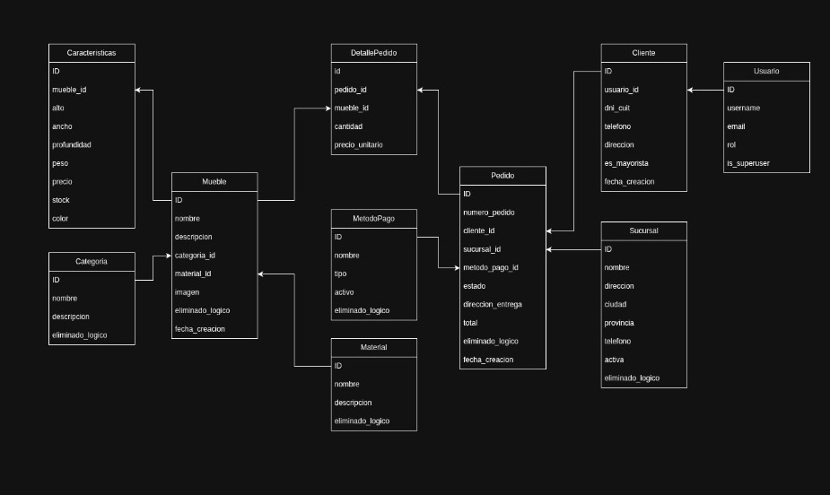
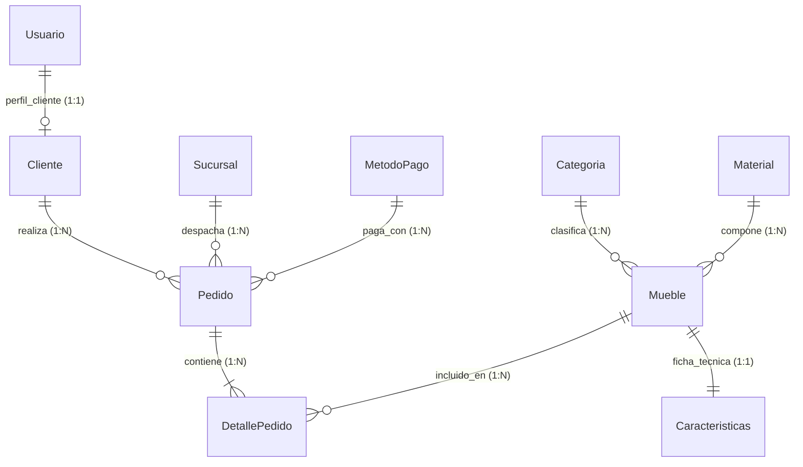
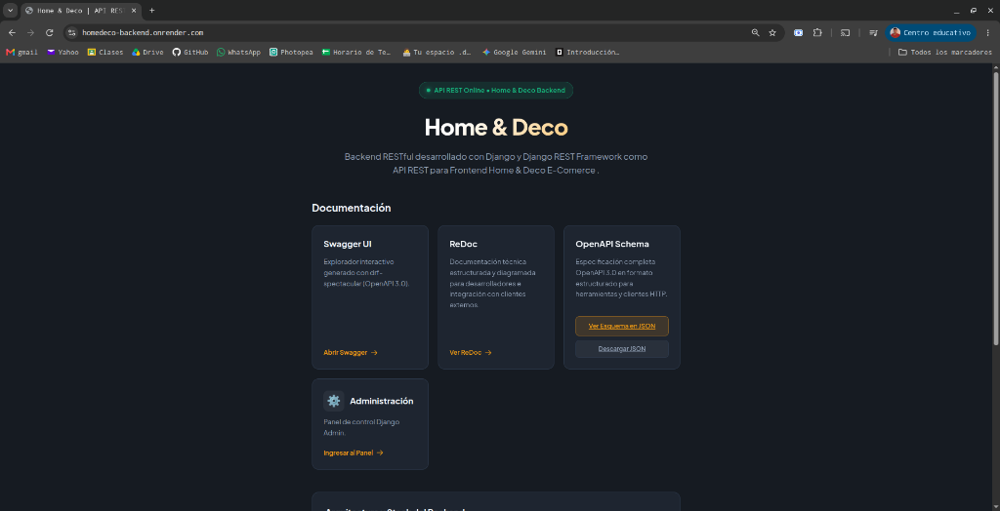
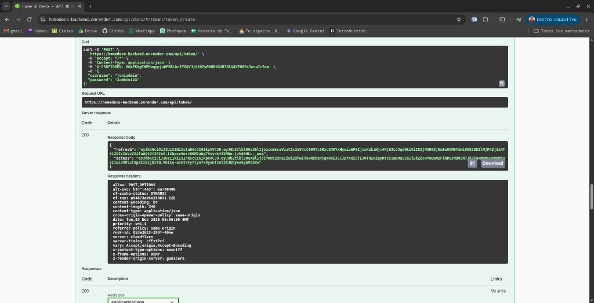
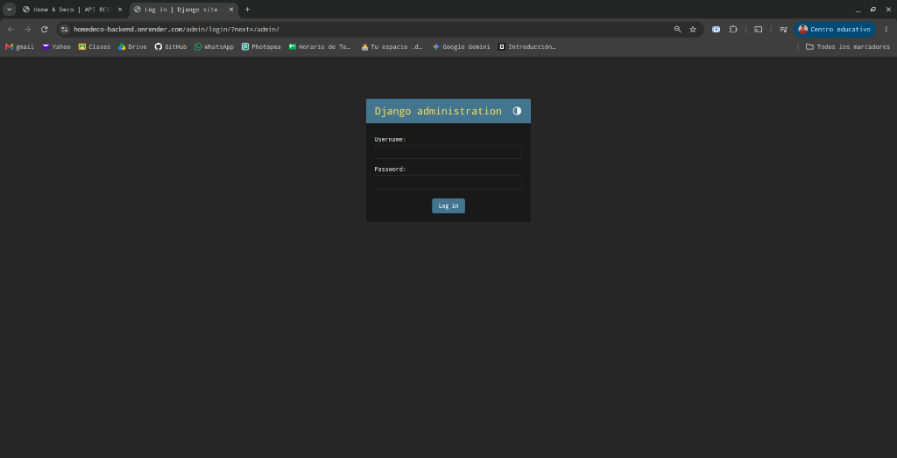
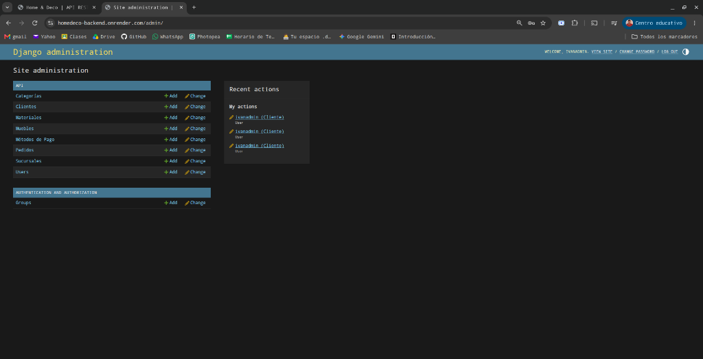
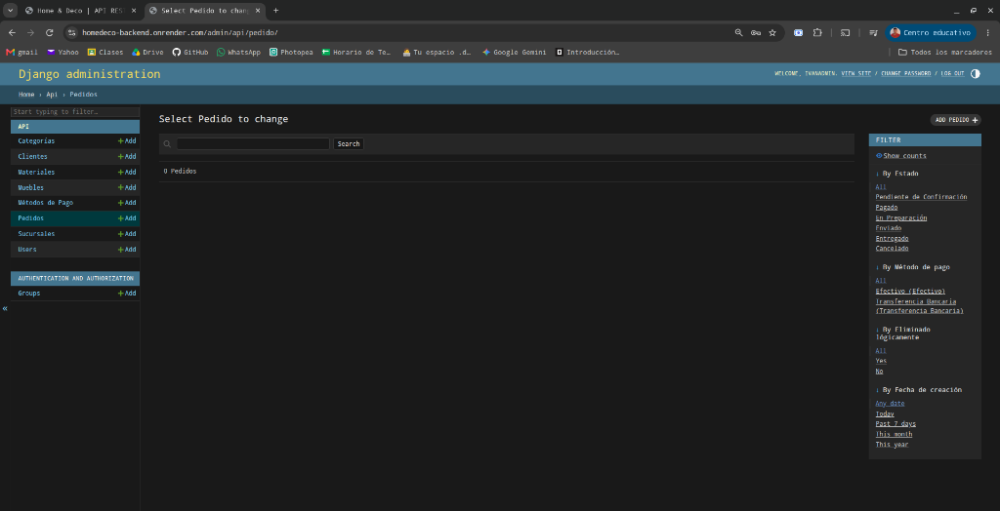

# 🛋️ Home & Deco — Backend API REST
> **Evaluación Final Integradora (EFI) — Ingeniería de Software**  
> **Carrera:** Tecnicatura Superior en Desarrollo de Software — ITEC Río Cuarto  
> **Docente a cargo:** Prof. Facundo Lemo  
> **Fecha de entrega:** Lunes 2 de Noviembre de 2026  

---

## 📋 1. Identidad y Propósito del Proyecto
**Home & Deco** es una solución a la gestión comercial y logística de una fábrica/tienda y decoración moderna de muebles.

El sistema comprende una **API RESTful** desarrollada con **Django REST Framework (DRF)**, diseñada para integrarse con un frontend en **Next.js** (desarrollado en el marco del espacio curricular de *Programación III*).

### Capacidades principales:
* **Catálogo Técnico & Comercial:** Modelado de muebles con materiales, categorías, dimensiones, peso, colores y control de stock.
* **Transacciones y Pedidos:** Gestión completa de pedidos (estados, sucursales, métodos de pago, etc).
* **Reglas de Negocio:** Validación de plazos de cancelación (límite 24 horas), congelamiento de precios históricos en detalles y borrado lógico (*soft-delete*) con opción de borrado físico reservado a un superadmin.
* **Seguridad & Roles:** Autenticación dual (SimpleJWT y Sesión) con separación de roles (`ADMIN`, `EMPLEADO`, `CLIENTE`).
* **Documentación:** OpenAPI 3.0 servida con Swagger UI, ReDoc y exportación en formato JSON.

---

## 🗄️ 2. Planificación de la Base de Datos & Diagrama Entidad-Relación (DER)

Planificación de tablas y relaciones diseñada previamente en [Draw.io](https://app.diagrams.net/):

<p align="center">
  
</p>

El sistema implementa **10 modelos** relacionales:



---

## 🚀 3. Arquitectura de la API REST

### ViewSets
| Endpoint | ViewSet | Nested Serializer en `list` | Filtros y Búsqueda | Permisos |
|---|---|:---:|:---:|---|
| `/api/muebles/` | `MuebleViewSet` | **Sí** (`MuebleListSerializer`) | Nombre, descripción, categoría, material, precio min/max | Lectura pública / Escritura Empleado |
| `/api/pedidos/` | `PedidoViewSet` | **Sí** (`PedidoListSerializer`) | Número, estado, fecha, cliente | Clientes ven propios / Empleados ven todos |
| `/api/detalles-pedido/` | `DetallePedidoViewSet` | **Sí** (`DetallePedidoListSerializer`) | Mueble, pedido | Relativo al pedido del usuario |
| `/api/categorias/` | `CategoriaViewSet` | No | Nombre, descripción | Lectura pública / Escritura Empleado |
| `/api/materiales/` | `MaterialViewSet` | No | Nombre, descripción | Lectura pública / Escritura Empleado |
| `/api/sucursales/` | `SucursalViewSet` | No | Nombre, ciudad, provincia | Lectura pública / Escritura Empleado |
| `/api/metodos-pago/` | `MetodoPagoViewSet` | No | Nombre, tipo | Lectura pública / Escritura Empleado |
| `/api/clientes/` | `ClienteViewSet` | No | Username, email, DNI/CUIT | Empleado / Admin |
| `/api/caracteristicas/`| `CaracteristicasViewSet`| No | Mueble, color | Lectura pública / Escritura Empleado |

### Acciones Personalizadas (`@action`)
1. **`GET /api/muebles/destacados/`**:
   * Devuelve los muebles más vendidos o con inventario activo utilizando `MuebleListSerializer` con anotaciones calculadas.
2. **`POST /api/pedidos/{id}/cancelar/`**:
   * Cancela un pedido con reglas de negocio estrictas: solo permitido dentro de las **primeras 24 horas** desde su creación y si no ha sido enviado ni entregado. Valida pertenencia al usuario autenticado.
3. **`DELETE /api/categorias/{id}/borrado-fisico/`**:
   * Permite la eliminación física permanente (*hard delete*) de la base de datos, protegido exclusivamente con el permiso personalizado **`SoloSuperadmin`**.

### Autenticación y Seguridad
* **Autenticación por Token:** `rest_framework_simplejwt` vía `POST /api/token/` y `POST /api/token/refresh/`.
* **Autenticación de Sesión:** `rest_framework.authentication.SessionAuthentication` para interacción con Django Admin y la API navegable.
* **CORS:** Configurado mediante `django-cors-headers` para admitir comunicación con el frontend de Next.js (`http://localhost:3000`).

---

## 📑 4. Documentación de la API & Vistas

### 📐 Diagrama Entidad-Relación (Draw.io)
Planificación inicial de tablas, atributos y relaciones desarrollada en [Draw.io](https://app.diagrams.net/):

<p align="center">
  
</p>

---

### 🌐 Endpoints de Documentación & Vistas
* **Página de Bienvenida:** Renderizada en `/` con diseño responsive, métricas del servicio y accesos directos.
* **Swagger UI:** Disponible en [`/api/docs/`](http://127.0.0.1:8000/api/docs/) con soporte de autorización Bearer JWT persistente.
* **ReDoc:** Disponible en [`/api/redoc/`](http://127.0.0.1:8000/api/redoc/) servido localmente vía `drf-spectacular-sidecar`.
* **Esquemas OpenAPI 3.0:**
  * JSON (navegador/Postman): [`/api/schema/json/`](http://127.0.0.1:8000/api/schema/json/)
  * YAML (descarga directa): [`/api/schema/yaml/`](http://127.0.0.1:8000/api/schema/yaml/)
* **API Navegable DRF:** Explorador interactivo en [`/api/`](http://127.0.0.1:8000/api/) y login navegable en `/api-auth/`.
* **Panel de Administración:** [`/admin/`](http://127.0.0.1:8000/admin/) con gestión de catálogo con `StackedInline` de ficha técnica, filtros por fechas y categorías, y búsqueda avanzada.

---

## ⚙️ 5. Instalación y Ejecución Local

### Prerrequisitos
* Python 3.12+
* Gestor de entornos [**uv**](https://docs.astral.sh/uv/) instalado

### Paso a paso con `uv`:
```bash
# 1. Clonar el repositorio
git clone https://github.com/IvanDanielEscobar/EFI-IngenieriaDeSoftware.git
cd EFI-IngenieriaDeSoftware

# 2. Sincronizar dependencias
uv sync

# 3. Aplicar migraciones
uv run python manage.py migrate

# 4. Poblar datos iniciales
uv run python manage.py seed_data

# 5. Iniciar servidor de desarrollo
uv run python manage.py runserver
```

### Credenciales de Prueba (generadas en `seed_data`):
* **Superadministrador:** Usuario `admin` | Password: `adminpassword`
* **Empleado:** Usuario `vendedor1` | Password: `empleadopassword`
* **Cliente Regular:** Usuario `cliente_juan` | Password: `clientepassword`
* **Cliente Mayorista:** Usuario `cliente_deco_hogar` | Password: `clientepassword`

---

## 🐳 6. Ejecución con Docker & Docker Compose

El proyecto incluye configuración para levantar el entorno completo con PostgreSQL 16:

```bash
# Construir y levantar servicios en segundo plano
docker compose up --build -d

# Poblar la base de datos dentro del contenedor
docker compose exec backend uv run python manage.py seed_data

# Ver logs del contenedor
docker compose logs -f backend
```

---

## 🧪 7. Pruebas Automatizadas (Tests)

El proyecto cuenta con suite de pruebas unitarias y de integración que validan los modelos, reglas de negocio de cancelación y autenticación:

```bash
uv run python manage.py test api
```
*(12 pruebas automatizadas validadas exitosamente).*

---

## 📸 8. Capturas del Proyecto en Funcionamiento (Producción)

El sistema se encuentra desplegado y operativo en la nube:
> **URL Producción:** [https://homedeco-backend.onrender.com](https://homedeco-backend.onrender.com)

### 1. Vista de Bienvenida (Landing Page)
Interfaz principal que da la bienvenida al sistema y provee accesos rápidos a la documentación interactiva, especificaciones OpenAPI y panel de administración:

<p align="center">
  
</p>

### 2. Autenticación SimpleJWT en Swagger UI
Generación de tokens de acceso (`access`) y actualización (`refresh`) mediante `POST /api/token/` con respuesta HTTP 200 OK:

<p align="center">
  
</p>

### 3. Acceso Seguro al Panel de Administración
Pantalla de inicio de sesión de Django Admin (`/admin/login/`) protegida por credenciales de usuario con privilegios de staff:

<p align="center">
  
</p>

### 4. Panel de Control y Administración de Modelos
Visión global del panel con los 10 modelos administrables clasificados por módulos de negocio (Catálogo, Clientes, Transacciones, Usuarios):

<p align="center">
  
</p>

### 5. Control de Pedidos con Filtros Avanzados
Gestión integral de transacciones de compra con barra lateral de filtrado por estado (`Pendiente`, `Pagado`, `En Preparación`, etc.), método de pago, baja lógica y fechas:

<p align="center">
  
</p>

---

## 👥 9. Integrantes del Equipo
* **Ivan Daniel Escobar**
* **Matias Ibarra**
* **Santiago Garay**
* **Jonatan Villavicencio**
